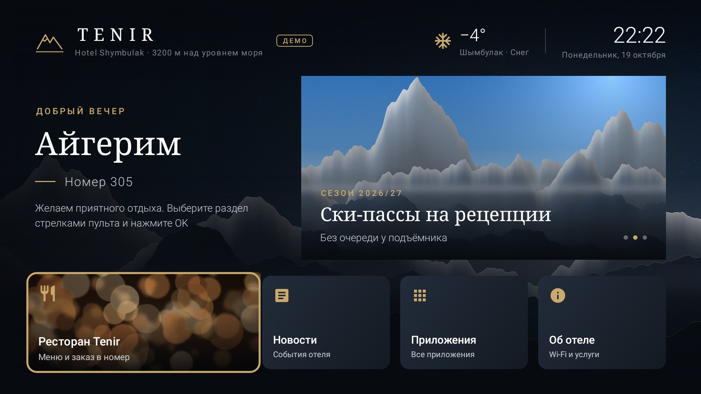

# TENIR TV

Гостиничный домашний экран (лаунчер) для телевизоров с Android TV Box: приветствие гостя по данным Hotel Hub,
время и погода, баннеры и новости отеля, меню ресторана, запуск Netflix и YouTube, раздел «Об отеле» с Wi-Fi.
Управление только пультом. Интерфейс рассчитан на 4K UHD и одинаково выглядит в 720p и Full HD.

Аудит исходного проекта LauncherCompose и обоснование выбранной реализации — [docs/audit.md](docs/audit.md).
Интеграция с Hotel Hub — [docs/hotel-hub.md](docs/hotel-hub.md). Формат серверного контента — [docs/content-format.md](docs/content-format.md).
Сервис управления телевизорами **TENIR TV Cloud** (учёт приставок, дизайн, контент, гости) — [server/](server/README.md),
ТЗ — [docs/backend.md](docs/backend.md).

Три режима работы приставки (сервисное меню или `device.json`):

| Режим | Как включить | Откуда гость и контент |
|---|---|---|
| **Облако** (рекомендуется) | `cloudUrl` | TENIR TV Cloud: подключение по коду, гость своего номера, контент и дизайн из панели, сообщения, команды |
| Hotel Hub напрямую | `hubUrl`, `propertyCode`, `hubToken`, `room`, `contentUrl`; `demoMode: false` | хаб и статический `content.json` |
| Демо | по умолчанию | встроенный демо-гость и контент |



## Возможности MVP

**Главный экран**
- логотип и название отеля, подпись (из контента; без логотипа — встроенный знак «горы»);
- персональное приветствие по времени суток («Добрый вечер») и имя гостя, номер комнаты — только при подтверждённом
  проживании; иначе «Добро пожаловать»;
- часы и дата в часовом поясе отеля, погода Open-Meteo (без ключа API, кеш до 3 часов);
- карусель баннеров с плавной сменой (стрелки ← → на баннере листают слайды, OK — действие баннера);
- плитки разделов, набор и порядок задаются сервером: ресторан (с фото), Netflix, YouTube, новости, все приложения,
  «Об отеле»; плитки Netflix/YouTube появляются только если приложение установлено и запускается;
- метка «Нет сети» при потере подключения, метка «Демо» в демо-режиме.

**Разделы:** ресторан (категории слева, блюда с ценами справа, фото блюд по желанию), новости (список + статья),
«Об отеле» (текст, Wi-Fi, рецепция), все приложения (баннеры Android TV / иконки), сервисное меню.

**Пульт:** полная навигация D-pad, заметный фокус (увеличение 1,07–1,08, золотая рамка, тень), OK — открыть,
Back — назад (на главном экране Back не закрывает лаунчер), стартовый фокус ставится на первую плитку при каждом
открытии экрана; после возврата из приложения фокус восстанавливается. Сенсорный экран и мышь не нужны.

**Hotel Hub:** данные номера и гостя через существующие маршруты API v1; данные гостя очищаются при выезде,
устаревают при недоступности хаба, скрываются после часа выезда, не пишутся на диск. Подробно — docs/hotel-hub.md.

**Серверный контент:** логотип, название, фон, цвет акцента, баннеры, новости, ресторан и меню, язык (ru/en/kk),
настройки отображения, набор плиток, параметры опроса хаба. Кеш на диске, ETag, кеш изображений до 150 МБ,
работа без интернета на последней версии.

**Устройство:** категория HOME + LEANBACK_LAUNCHER, автозапуск после загрузки (см. «Установка»), режим владельца
устройства (закрепить лаунчер, очищать данные Netflix/YouTube при выезде), диагностика: Ethernet/Wi-Fi,
режимы экрана и вывод 4K, HDR, аппаратные декодеры H.264/HEVC/VP9/AV1 с проверкой 4K@30.

## Устройство проекта

```
tenir-tv/
  core/   Kotlin без Android: контент (модель, разбор, кеш), клиент Hotel Hub, сессия гостя, приветствия,
          погода, выбор плиток приложений, масштаб; JVM-тесты
  app/    Android-приложение (framework Views, без AndroidX): экраны ui/*, AppContainer (зависимости и фоновые
          опросы), data/* (HTTP, хранилища, запуск приложений), image/ImageLoader, system/* (автозапуск,
          владелец устройства, диагностика); Robolectric-тесты в app/src/test
  server/ TENIR TV Cloud (Python, FastAPI): API приставок, панель администратора, опрос Hotel Hub; pytest
  tools/  build-offline.sh — сборка APK без Google Maven; gen_demo_assets.py — демо-изображения
  docs/   аудит, интеграция, формат контента, ТЗ backend, пример device.json, снимки экранов
```

Сетевые запросы — только в фоновых потоках (`AppContainer`, пул `ImageLoader`), главный поток получает готовые
значения через `Observable`. Таймауты HTTP 7/10 с, при ошибках интервал опроса хаба растёт.

Новый экран: класс-наследник `BaseTvActivity` (масштаб, язык, стартовый фокус), запись в манифесте, id плитки в
`Tiles`, ветка в `HomeActivity.renderTiles`, поля контента в `core/content`.

## Сборка

Требования: JDK 17+, Android SDK (compileSdk 34), доступ к Google Maven и Maven Central.

```bash
cd tenir-tv
./gradlew :core:test            # JVM-тесты ядра
./gradlew :app:testDebugUnitTest # Robolectric: экраны, пульт, 1080p/4K/720p
./gradlew :app:assembleRelease   # app/build/outputs/apk/release/app-release.apk (подпись отладочным ключом)
```

Без Google Maven (закрытый контур — как в среде, где разрабатывался MVP):

```bash
sudo apt-get install aapt dalvik-exchange zipalign apksigner android-sdk-platform-23 zip
tools/build-offline.sh          # → dist/tenir-tv-0.1.0.apk
```

Скрипт берёт из Maven Central компилятор Kotlin, ProGuard и `android-all` (классы и ресурсы Android 14,
публикуются проектом Robolectric), собирает тот же код с minSdk 24 / targetSdk 34 и подписывает ключом из
`~/.cache/tenir-offline/debug.keystore` (или `TENIR_KEYSTORE`, `TENIR_KEYSTORE_PASS`, `TENIR_KEY_ALIAS`).
Для эксплуатации подпишите APK постоянным ключом отеля: обновление поверх установленной версии возможно только
тем же ключом.

### Результаты сборки и тестов (20.10.2026, версия 0.2.0)

Gradle 8.9, AGP 8.5.2, Kotlin 2.0.21, Android SDK 34, JDK 21:

| Проверка | Результат |
|---|---|
| `./gradlew :core:test` | 35 тестов, 0 ошибок (+1 сквозной с настоящим сервисом: `TENIR_CLOUD_E2E_URL=…`, пройден) |
| `./gradlew :app:testDebugUnitTest` (Robolectric 4.14.1, нативная графика) | 16 тестов, 0 ошибок; снимки 720p, 1080p, 3840×2160 и облачного режима — `docs/screenshots` |
| `server: pytest` | 15 тестов, 0 ошибок; `ruff` — без замечаний |
| `./gradlew :app:lintRelease` | 0 ошибок; предупреждения — в основном поля сервисного меню без автозаполнения |
| `./gradlew :app:assembleRelease` | `app-release.apk`, ~0,9 МБ (R8), minSdk 24, targetSdk 34, подпись отладочным ключом |
| `tools/build-offline.sh` | `dist/tenir-tv-0.2.0.apk`, ~1 МБ — запасная сборка без Google Maven |

## Установка на Android TV Box

**С облаком:** развернуть TENIR TV Cloud ([server/README.md](server/README.md)), в нём указать хаб и токен;
на приставке — только `"cloudUrl"` в `device.json` (или поле в сервисном меню), затем ввести код с экрана в панели.
Шаги 1–2 ниже тогда не нужны.

1. **Hotel Hub:** страница «API» → новый потребитель «TENIR TV», права `occupancy` и `guests`, скопировать токен.
2. **Контент:** опубликовать `content.json` (пример — `app/src/main/assets/content-demo.json`) на HTTPS-сервере.
3. **Приставка:** включить «Для разработчиков» → «Отладка по USB/сети», подключить Ethernet. Затем:

```bash
adb connect 192.168.1.50:5555
adb install -r tenir-tv-0.2.0.apk

# настройки номера: файл применяется при запуске и удаляется (токен не остаётся в общей памяти)
adb shell mkdir -p /sdcard/Android/data/kz.tenir.tv/files
adb push device.json /sdcard/Android/data/kz.tenir.tv/files/device.json     # см. docs/device.example.json

# TENIR TV — домашний экран
adb shell cmd package set-home-activity kz.tenir.tv/.ui.home.HomeActivity
# на прошивках без этой команды: нажать HOME и выбрать TENIR TV «всегда»
# (или сервисное меню → «Выбрать домашний экран»)

# необязательно, только на сброшенной приставке без аккаунтов: владелец устройства —
# лаунчер закрепляется навсегда, при выезде очищаются данные приложений из hub.clearAppsOnCheckout
adb shell dpm set-device-owner kz.tenir.tv/.system.TenirDeviceAdmin

# автозапуск на Android 10+, если прошивка сбрасывает выбор домашнего экрана
adb shell appops set kz.tenir.tv SYSTEM_ALERT_WINDOW allow

adb reboot
```

Вместо `device.json` можно настроить на месте: на главном экране пультом **↑ ↑ ↓ ↓ ← → ← →**, PIN
(по умолчанию `0000` — смените), заполнить номер, адрес хаба, код отеля, токен, адрес контента, снять «Демо-гость»,
«Сохранить», «Проверить хаб».

Роль владельца устройства снимается только сбросом приставки к заводским настройкам — включайте её осознанно.

## Проверка на приставке (чек-лист приёмки)

1. После `adb reboot` открывается TENIR TV, фокус на первой плитке.
2. Сервисное меню → «Диагностика приставки»: сеть «Ethernet, интернет подтверждён», режим экрана 3840×2160 (или
   1920×1080), «Вывод 4K UHD: да», аппаратные HEVC/VP9 «4K@30 — да» (для 4K-видео в Netflix/YouTube).
3. Демо: приветствие «Айгерим», «Номер 305», метка «Демо».
4. Хаб: номер с заселённым гостем → через ≤ 1 мин имя гостя и номер; «Проверить хаб» показывает статус номера.
   Номер свободен или ожидается заезд → «Добро пожаловать», без номера.
5. Выезд в Exely → после синхронизации хаба и ≤ `pollSeconds` имя пропадает; в журнале сервисного меню
   «Выезд: стоянка … закрыта».
6. Выдернуть Ethernet: метка «Нет сети», разделы и меню открываются из кеша; через `maxAgeMinutes` имя гостя
   исчезает. Вернуть сеть — данные обновляются сами.
7. Пульт: стрелки по всем плиткам, ↑ на баннер, ← → листают баннеры, OK открывает разделы, Back возвращает.
8. Netflix/YouTube: плитки есть только при установленных приложениях; OK запускает; HOME возвращает в TENIR TV.
   Удалить приложение — плитка исчезает.
9. Язык: `"language": "en"` в контенте или в сервисном меню → интерфейс на английском.

## Ограничения и что проверить

- **Не проверено на реальной приставке и в эмуляторе.** Проверены Gradle-сборка, lint, JVM- и Robolectric-тесты
  с рендером. Нужно пройти чек-лист выше на целевой модели приставки.
- `minSdk 24` (Android 7.0+). Для Android 5–6 в Gradle-сборке можно понизить minSdk до 21 (AGP переносит недостающие методы Java 8), но офлайн-скрипт такую сборку не сделает, и на Android 5–6 приложение не проверялось.
- Автозапуск: надёжный путь — TENIR TV как домашний экран или владелец устройства. Часть прошивок (Xiaomi, некоторые
  Amlogic) принудительно возвращает свой лаунчер — это решается только настройками прошивки или MDM.
- Очистка данных Netflix/YouTube при выезде работает только в режиме владельца устройства и на Android 9+.
  Без него выход из аккаунтов приложений остаётся за персоналом (или через MDM).
- Имя гостя появляется/исчезает с задержкой синхронизации хаба (webhook + цикл 20 мин) плюс `pollSeconds`.
- Токен с правом `guests` даёт доступ ко всем гостям отеля; рекомендован узкий маршрут для ТВ (docs/hotel-hub.md).
- `Asia/Almaty` с 2024 года — UTC+5; на старых прошивках с устаревшей базой часовых поясов часы покажут +6.
  Тогда укажите `"timezone": "GMT+05:00"` в контенте.
- Аппаратное декодирование влияет только на видео во внешних приложениях: сам TENIR TV видео не воспроизводит
  (видеозаставки нет), диагностика показывает возможности приставки.
- Демо-изображения процедурные (без лицензионных ограничений); для эксплуатации нужны фото отеля в 4K.
- Ввод текста в сервисном меню идёт через системную экранную клавиатуру; на приставке без IME настройка — через
  `device.json`.
