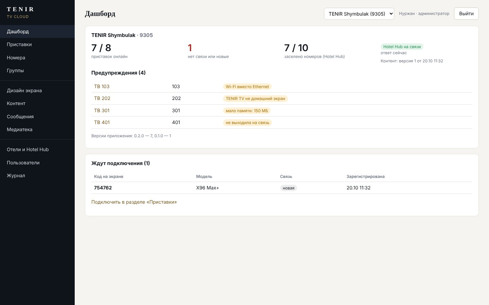

# TENIR TV Cloud

Сервис управления телевизорами TENIR TV: учёт и мониторинг приставок, подключение по коду с экрана,
дизайн главного экрана с предпросмотром, контент (баннеры, новости, ресторан, Wi-Fi) с публикацией версий,
группы номеров, сообщения на экран, удалённые команды. Данные гостей — из Hotel Hub, только на сервере и только
в памяти. ТЗ и обоснование — [../docs/backend.md](../docs/backend.md).

Стек как у Hotel Hub: Python 3.11+, FastAPI, SQLAlchemy 2 (SQLite), Jinja2, Pillow.



Снимки остальных страниц (приставки, карточка приставки, номера, дизайн с предпросмотром, контент, группа,
сообщения) — `../docs/screenshots/panel-*.jpg`; экран телевизора с кодом подключения и сообщением —
`home-1080p-cloud-*.jpg`.

## Запуск

```bash
cd tenir-tv/server
python3 -m venv .venv && .venv/bin/pip install -e '.[dev]'
.venv/bin/pytest                                   # 15 тестов
TENIR_CLOUD_HTTPS=0 .venv/bin/tenircloud --data ./data serve --port 8090   # локально по HTTP
```

Откройте `http://127.0.0.1:8090` → первый вход создаёт администратора → «Отели и Hotel Hub»:
код отеля как в хабе (например `9305`), адрес хаба, токен потребителя с правами `occupancy` и `guests`,
«Проверить Hotel Hub и обновить номера».

Переменные окружения:

| Переменная | Значение |
|---|---|
| `TENIR_CLOUD_DATA` | каталог данных: база `cloud.db`, `media/`, ключи `fernet.key`, `session.key` (по умолчанию `./data`) |
| `TENIR_CLOUD_PUBLIC_URL` | адрес, по которому сервис видят приставки (для ссылок на изображения), например `https://tv.tenir.kz` |
| `TENIR_CLOUD_HTTPS` | `1` (по умолчанию) — cookie панели только по HTTPS; `0` — для локальной проверки |

Сброс пароля: `tenircloud --data ./data passwd admin`.

## Эксплуатация

- **systemd:** `ExecStart=/opt/tenircloud/.venv/bin/tenircloud --data /var/lib/tenircloud serve --host 127.0.0.1 --port 8090`,
  пользователь без входа в систему, `Restart=always`.
- **nginx:** TLS, `proxy_pass http://127.0.0.1:8090`, `proxy_set_header X-Forwarded-Proto $scheme`,
  `client_max_body_size 30m` (загрузка фото 4K). `/media/` можно отдавать напрямую из
  `/var/lib/tenircloud/media` с `expires max`.
- **Резервная копия:** каталог данных целиком (`sqlite3 cloud.db ".backup …"` для базы). Имён гостей в копиях нет.
  Без `fernet.key` сохранённый токен хаба не расшифровать — храните ключ вместе с копией, но отдельно от чужих глаз.
- **Нагрузка:** heartbeat раз в минуту от каждой приставки; 200 приставок ≈ 3,3 запроса в секунду.

## Подключение приставки

1. Установить TENIR TV 0.2.0+, в сервисном меню (на главном экране ↑ ↑ ↓ ↓ ← → ← →, PIN) указать
   «Адрес TENIR TV Cloud» — или `"cloudUrl"` в `device.json`.
2. На экране телевизора появится 6-значный код.
3. Панель → «Приставки» → ввести код, выбрать номер → «Подключить». Через ≤ 1 минуту телевизор покажет контент
   отеля и приветствие гостя номера.

## Устройство

```
tenircloud/
  app.py       сборка приложения, фоновый опрос хаба
  db.py        модели: пользователи, отели, группы, номера, приставки, черновик и версии контента,
               сообщения, команды, медиафайлы, журнал
  tvapi.py     API приставок /api/tv/v1: register, heartbeat, content (ETag), commands/{id}/ack
  hubsync.py   Hotel Hub: rooms + guests, имена только в памяти, выезд, недоступность, отказ токена
  content.py   черновик, публикация, откат, переопределения групп, документ для приставки
  admin.py     панель (роли admin / editor / viewer, журнал, защита от CSRF по Origin)
  media.py     загрузка изображений (до 3840 px), раздача /media
  templates/   страницы панели, preview.html — главный экран 960×540
```

## Что не сделано в этапе 1

- 2FA для входа в панель, обновление APK по воздуху, уведомления о падении приставок — этап 2.
- Отчёты (онлайн по дням, разделы, приложения, занятость, CSV) — этап 3.
- Ограничение частоты heartbeat на приставку (есть только на регистрацию), сравнение версий контента
  (есть предпросмотр любой версии и откат).
- PostgreSQL: схема переносима, но проверялась только на SQLite.
